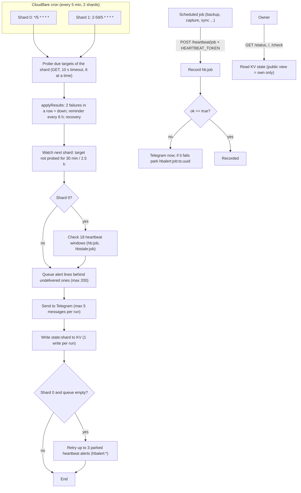

# 01 — Business process (As-Is / To-Be)

repo นี้คือ Cloudflare Worker `solo-empire-monitor` ที่เป็น "ทางเดียวของ alert" สำหรับ uptime และ heartbeat ของ scheduled jobs ทั้งหมดของเจ้าของ (รวม client services ที่เราโฮสต์ ยกเว้น Happy Teeth) ไม่มีผู้ใช้ภายนอก ผู้รับผลคือเจ้าของคนเดียวผ่าน Telegram

ณ `origin/main` `fe04d27` (2026-11-03): 65 targets ใน `src/targets.ts` (own 55, client 10; 40 ตัวเป็น Railway sleeping service ที่ probe ชั่วโมงละครั้ง) และ 18 heartbeat jobs

## As-Is (จากโค้ดวันนี้)

Sources: `src/worker.ts`, `src/monitor.ts`, `src/targets.ts`, `wrangler.toml`, `PRODUCT.md`, `README.md`

## To-Be

ไม่มี `specs/` หรือ `docs/UPGRADE-PLAN.md` ใน repo และ `PRODUCT.md` ไม่มีแผนอนาคต มีเพียงข้อจำกัดที่บันทึกไว้ ("Limits") และ reversal triggers ใน central ADR-0002 จึงไม่วาด To-Be

สิ่งที่ repo docs ระบุว่ายังขาด (ไม่ใช่แผนที่อนุมัติ):

- "If both shard crons stop, nothing inside this Worker can report it; that needs an outside check." (`PRODUCT.md`, central R-08 / BL-06)
- Public `/status` cache miss อาจกิน KV read ของ free plan; แนวทางที่ README เสนอคือ Cloudflare rate-limiting rule หรือ Workers Paid (`README.md` "Known limits")
- เกิน ~70 targets ต้องเพิ่ม shard ที่ 3 หรือย้ายไป paid plan ([central ADR-0002](https://github.com/bookchaowalit/architecture-docs/blob/main/docs/architecture/decisions/ADR-0002-production-baseline-monitoring-backups.md))
- ops record: book-platforms-status (2026-11-03) ระบุว่า `payment-api` จะเพิ่มเข้า uptime-worker หลังเจ้าของตั้ง Stripe sandbox key

## Open questions

- To-Be ของ monitor: จะทำ external dead-man check (BL-06) แบบไหน และเมื่อไร
- `PRODUCT.md` ยังเขียน "52 targets" และ "31 sleeping" แต่โค้ดมี 65 / 40 และ heartbeat list ใน `PRODUCT.md` ขาด `jobs-marts`, `job-radar`, `posture-monitor` ควรอัปเดตหรือไม่
