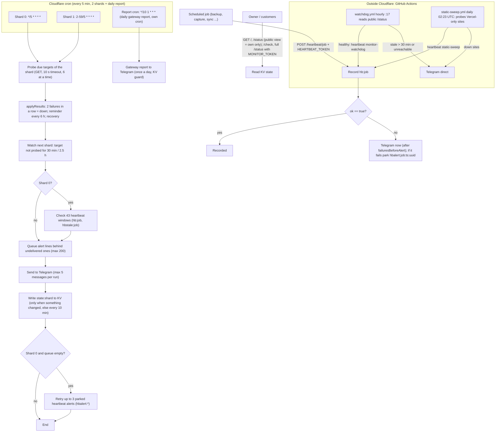

# 01 — Business process (As-Is / To-Be)

repo นี้คือ Cloudflare Worker `solo-empire-monitor` ที่เป็น "ทางเดียวของ alert" สำหรับ uptime และ heartbeat ของ scheduled jobs ทั้งหมดของเจ้าของ (รวม client services ที่เราโฮสต์ ยกเว้น Happy Teeth) ผู้รับผลคือเจ้าของคนเดียวผ่าน Telegram; หน้า `/` เป็น status page สาธารณะของ service ที่เป็นของเราเอง

Last reviewed: 2026-11-27 · commit `15759bb`

ณ `origin/main` `15759bb`: 61 targets ใน `src/targets.ts` (own 55, client 6; 36 ตัวเป็น Railway sleeping service ที่ probe ชั่วโมงละครั้ง) และ 43 heartbeat jobs

## As-Is (จากโค้ดวันนี้)

Sources: `src/worker.ts`, `src/monitor.ts`, `src/targets.ts`, `src/watchdog.ts`, `src/static-sweep.ts`, `src/status-page.ts`, `src/gateway-report.ts`, `wrangler.toml`, `.github/workflows/watchdog.yml`, `.github/workflows/static-sweep.yml`, `specs/001-monitor-watchdog/spec.md`, `specs/002-public-status-page/spec.md`, `specs/003-static-sweep/spec.md`, `README.md`

## To-Be

ไม่มี To-Be ที่เขียนไว้ ตอนนี้ `specs/001`-`003` (watchdog, status page, static sweep) ถูกทำครบและอยู่ใน As-Is แล้ว `PRODUCT.md` มีเพียง Limits และ README มี Known limits ซึ่งเป็นข้อจำกัดที่ยอมรับ ไม่ใช่แผนที่อนุมัติ จึงไม่วาด To-Be

ข้อจำกัดที่บันทึกไว้ (ไม่ใช่แผน):

- Public `/status` cache miss อาจกิน KV read ของ free plan; แนวทางที่ README เสนอคือ Cloudflare rate-limiting rule หรือ Workers Paid (`README.md` "Known limits")
- เกิน ~70 targets ต้องเพิ่ม shard ที่ 3 หรือย้ายไป paid plan ([central ADR-0002](https://github.com/bookchaowalit/architecture-docs/blob/main/docs/architecture/decisions/ADR-0002-production-baseline-monitoring-backups.md)); ตอนนี้ 61 targets

## Gap

| ID | As-Is → To-Be | Status | Owner | Evidence |
|---|---|---|---|---|
| G1 | both shard crons stop = nobody notices → outside check reads `/status` and Worker watches it back | done | claude | `specs/001-monitor-watchdog/spec.md`, `.github/workflows/watchdog.yml`, `src/watchdog.ts`, heartbeat `monitor-watchdog` in `src/targets.ts` |
| G2 | `PRODUCT.md` says 52 targets / 31 sleeping and lists 9 heartbeat jobs → matches code (61 / 36 / 43 jobs) | todo | claude | `PRODUCT.md` "What works today" vs `src/targets.ts` |
| G3 | no written To-Be for the free-plan limits (public `/status` KV flood, third shard past ~70 targets) → owner picks a target or accepts the limits | decide | owner | `README.md` "Known limits"; ADR-0002 |

## Open questions

- ต้องการ rate-limiting rule บน `/status` หรือรับความเสี่ยงต่อไป (G3) และเมื่อไรจึงจะเพิ่ม shard ที่ 3
- `payment-api` อยู่ใน `src/targets.ts` แล้ว (probe `/readyz`) ไม่มีรายการค้างจาก ops record เดิม
