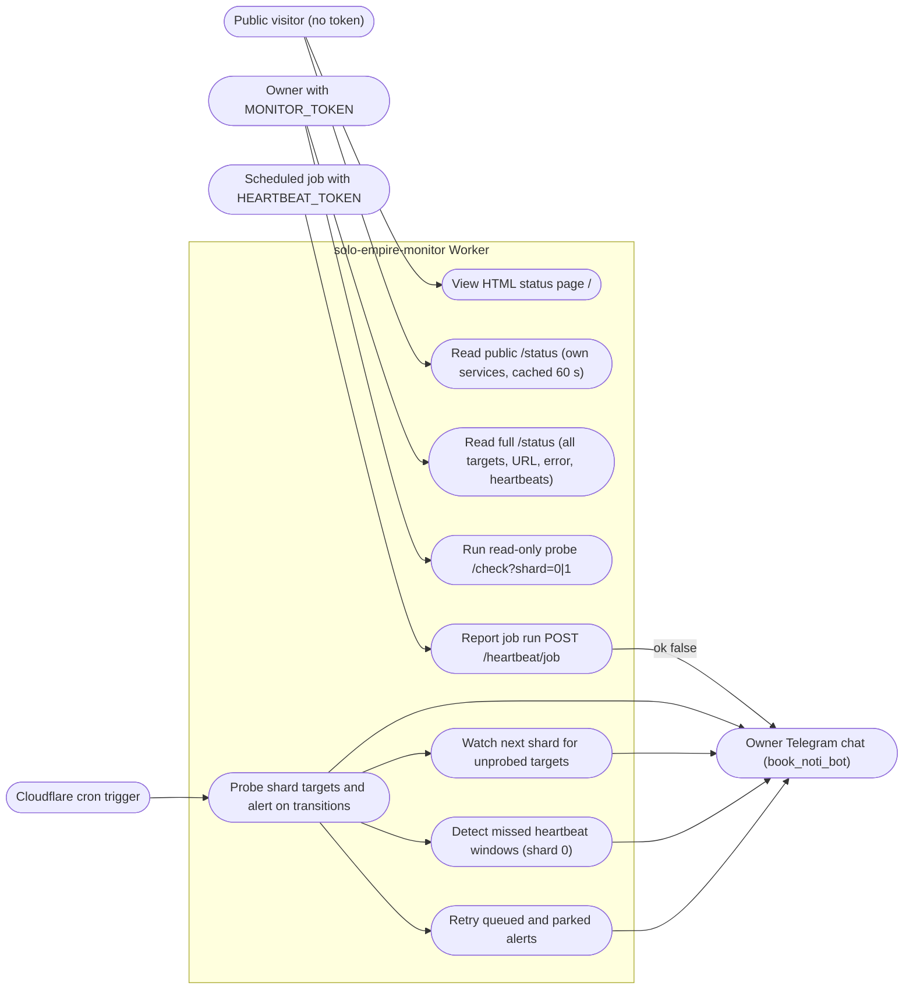

# 02 — Use cases

Actors มาจากระดับ auth จริงใน `src/worker.ts`: ไม่มี token (public), `MONITOR_TOKEN` (owner/operator), `HEARTBEAT_TOKEN` (scheduled jobs) และ cron trigger ของ Cloudflare ฝั่งรับคือ Telegram chat ของเจ้าของ

Sources: `src/worker.ts` (`authorized`, `handleStatus`, `handleManualCheck`, `handleHeartbeat`, `scheduled`, `runShard`), `src/targets.ts` (`HEARTBEATS`), `README.md` (Deploy, Telegram bot)

| Actor | Auth ในโค้ด | Use cases |
|---|---|---|
| Public visitor | ไม่มี; token ผิดถือเป็น public (`test/worker.test.ts` "treats a wrong token as a public request") | UC1, UC2 |
| Owner | `Authorization: Bearer <MONITOR_TOKEN>`; ถ้าไม่ตั้ง secret `/check` ตอบ 503 | UC3, UC4 |
| Scheduled job | `Authorization: Bearer <HEARTBEAT_TOKEN>`; job ต้องอยู่ใน `HEARTBEATS` ไม่งั้น 404 | UC5 |
| Cron trigger | `scheduled()` จาก `wrangler.toml` `[triggers]` | UC6–UC9 |

Heartbeat callers ที่ระบุใน comment ของ `src/targets.ts`: platform-db-backup (`db-backup*`, `restore-drill`), platform-empire (`token-rotate`, `backlog-sync`), career-job-scraper (`job-capture`), content-news-scraper (`news-capture`), life-checkin-worker (`checkin-daily`), data-lake-pipelines (`sheet-summaries`, `registry-export`, `jobs-marts`), sales-crm (`job-radar`), platform-posture-monitor (`posture-monitor`)

## Open questions

- ทุก job ใช้ `HEARTBEAT_TOKEN` ตัวเดียวกัน จึงแยกไม่ได้ว่า caller ไหนส่ง heartbeat ของ job ไหน ตั้งใจหรือไม่
