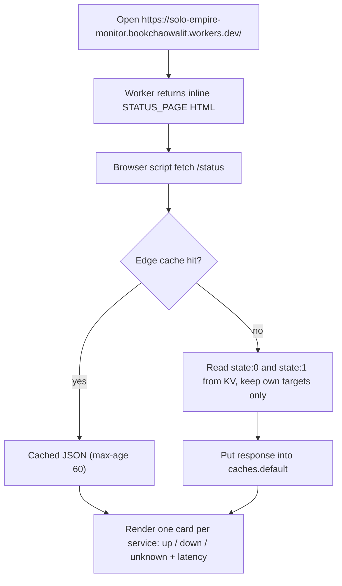
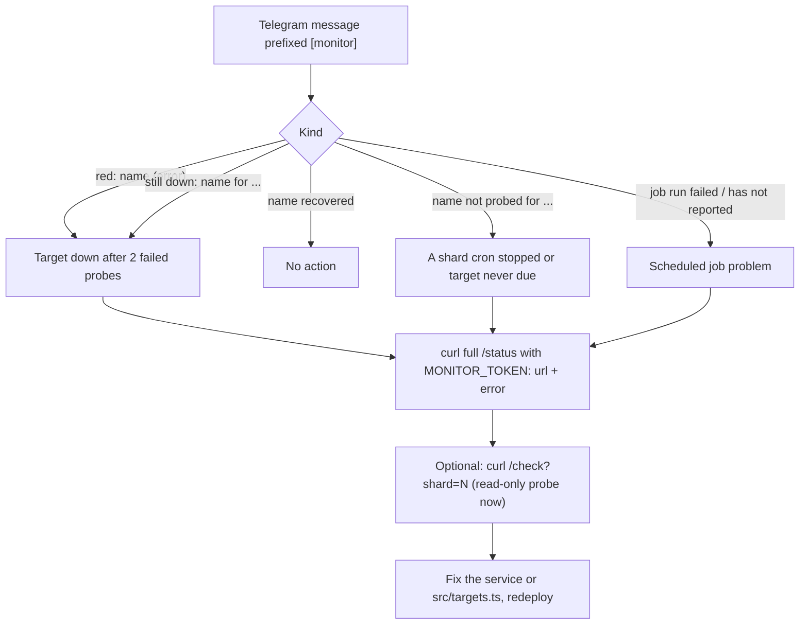
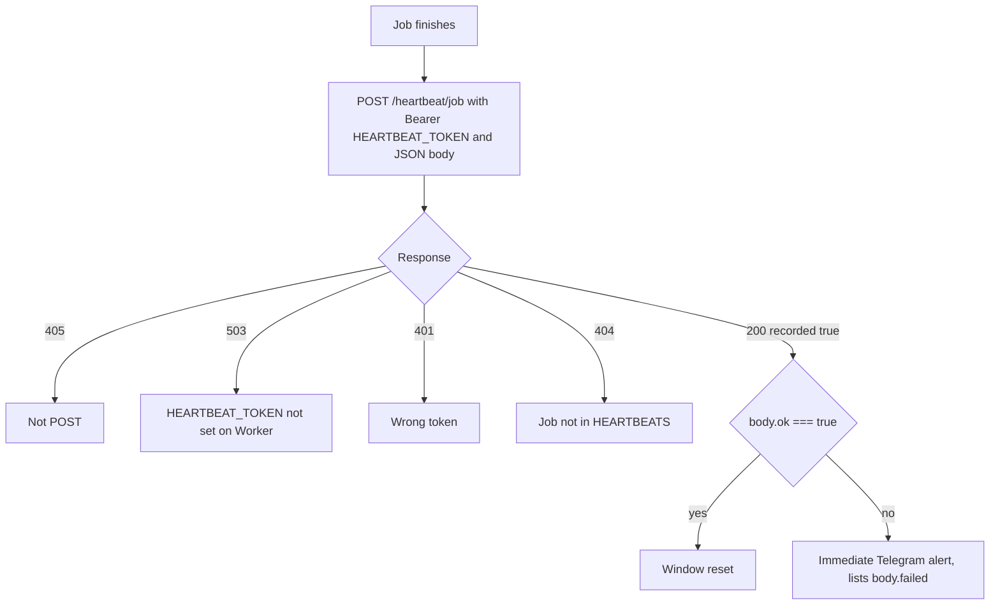

# 03 — User flows

Worker นี้มี "หน้า" เดียวคือ HTML status page ที่ `/` ซึ่ง fetch `/status` ฝั่ง browser นอกนั้นเป็น HTTP API และข้อความ Telegram จึงเขียน flow ต่อ role

## Public visitor: ดูหน้าสถานะ

## Owner: รับ alert แล้วตรวจ

## Scheduled job: รายงานผล

Sources: `src/worker.ts` (`STATUS_PAGE`, `handleStatus`, `handleManualCheck`, `handleHeartbeat`), `src/monitor.ts` (`formatTransitions`, `staleTargets`), `README.md` (Usage), central [12-operations-maintenance.md](https://github.com/bookchaowalit/architecture-docs/blob/main/operations/platform/devsecops-phase2-prod-baseline/12-operations-maintenance.md) (runbook table)

## Open questions

- หน้า `/` ไม่แสดง `stale` flag ที่ `/status` ส่งมา ตั้งใจหรือไม่
