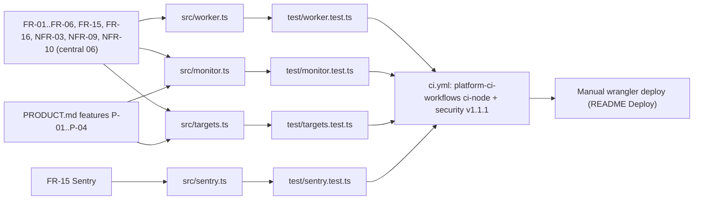

# 04 — Traceability (RTM)

repo นี้ไม่มี `specs/` requirement อยู่ใน central workspace PRJ-DSO-02 ([06-requirements-engineering.md](https://github.com/bookchaowalit/architecture-docs/blob/main/operations/platform/devsecops-phase2-prod-baseline/06-requirements-engineering.md), FR/NFR ที่เกี่ยวกับ monitor) และ `PRODUCT.md` "What works today" (ใส่รหัส P-xx ในตารางนี้) ตาราง RTM ด้านล่างโยง requirement → code → test → release

Release สำหรับทุกแถว: ไม่มี CD; ปล่อยด้วย `npx wrangler deploy` แบบ manual (`README.md` Deploy) หลัง CI `.github/workflows/ci.yml` บน `main`

| Req | ข้อความย่อ | Code | Test | หมายเหตุ |
|---|---|---|---|---|
| FR-01 | probe ทุก target ทุก 5 นาที, 2 shards, 6 concurrent, 10 s timeout | `wrangler.toml` crons, `worker.ts` `SHARD_CRONS`, `PROBE_CONCURRENCY`, `checkTarget`; `monitor.ts` `targetsForShard`, `mapWithConcurrency` | `monitor.test.ts` "shard assignment", "mapWithConcurrency"; `targets.test.ts` "shards"; `worker.test.ts` "runs the second cron as shard 1" | FR-01 เขียน "26 targets per shard"; ปัจจุบัน 39 / 26 (hash split) |
| FR-02 | down หลัง 2 fail, reminder 6 h, recovery, blip ถูกลืม | `monitor.ts` `applyResults`, `FAILURES_BEFORE_DOWN`, `REMINDER_HOURS` | `monitor.test.ts` "applyResults" (4 cases); `worker.test.ts` "alerts after two failures in a row, then on recovery" | |
| FR-03 | alert ที่ Telegram ไม่รับ ถูก queue และ retry ก่อน alert ใหม่ | `worker.ts` `deliver`, `pendingAlerts`; `monitor.ts` `queueAlerts`, `chunkAlerts` | `monitor.test.ts` "queueAlerts", "chunkAlerts"; `worker.test.ts` "keeps an undelivered alert queued" | FR-03 เขียน cap 40; โค้ด `MAX_PENDING_ALERTS = 200` |
| FR-04 | `POST /heartbeat/<job>` + token, `ok:false` alert ทันที, missed window alert, stale time ใน key แยก | `worker.ts` `handleHeartbeat`, `staleKey`, `hbAlertKey`; `monitor.ts` `staleHeartbeats`; `targets.ts` `HEARTBEATS` | `worker.test.ts` "/heartbeat/<job>" (7 cases), "on shard 0, alerts once for a heartbeat that never reported"; `monitor.test.ts` "staleHeartbeats"; `targets.test.ts` "HEARTBEATS" | jobs ขยายจาก 6 เป็น 18 |
| FR-05 | `/` และ public `/status` แสดง own เท่านั้น; full view ด้วย `MONITOR_TOKEN`; `/check` | `worker.ts` `handleStatus`, `handleManualCheck`, `STATUS_PAGE` | `worker.test.ts` "routing", "/status" (5), "/check" (4) | |
| FR-06 | coverage: own + client, Happy Teeth absent | `targets.ts` `ALL_TARGETS` | `targets.test.ts` "never monitors the Happy-Teeth org", "uses only the own and client groups" | FR-06 เขียน 52; ปัจจุบัน 65 |
| FR-15 | Sentry errors only, init เมื่อมี `SENTRY_DSN` | `src/sentry.ts` | `sentry.test.ts` (10 cases); `worker.test.ts` "with SENTRY_DSN set" | |
| FR-16 | alert ทั้งหมดไป Telegram bot | `worker.ts` `sendTelegram` | `worker.test.ts` (stubbed fetch ไป api.telegram.org) | bot ปัจจุบัน `book_noti_bot` (`README.md`) |
| NFR-03 | KV writes ≤ 1,000/day, < 50 subrequests ต่อ shard | `worker.ts` `MAX_MESSAGES_PER_RUN`, `MAX_PARKED_PER_RUN`, one `put(stateKey)` per run | `monitor.test.ts` "keeps the probes, messages and parked sends of every shard under 50 subrequests"; `targets.test.ts` "keeps every shard under the free-plan subrequest budget" | |
| NFR-09 | public view ไม่มี client, URL, error | `worker.ts` `handleStatus` filter `group === 'own'` | `worker.test.ts` "shows only own services publicly, without URLs, errors or heartbeats" | |
| NFR-10 | ไม่มี Happy Teeth | `targets.ts` comment + list | `targets.test.ts` Happy-Teeth case | |
| P-01 | sleeping Railway services probe hourly | `targets.ts` `SLEEPS`; `monitor.ts` `isDue` | `monitor.test.ts` "isDue"; `targets.test.ts` sleeping cases, Book Platform `/readyz` case | PR #3 |
| P-02 | stable name-hash shards + stopped-cron watch (TD-004) | `monitor.ts` `shardOfName`, `handoverStates`, `newestStates`, `mergeShardStates`, `staleTargets`, `watchedShard` | `monitor.test.ts` "shard state hygiene (TD-004)" (7), "staleTargets (TD-004)" (6) | |
| P-03 | `/status` `stale: true` เมื่อ probe เก่ากว่า 30 min / 2.5 h | `monitor.ts` `isStale`, `STALE_AFTER_HOURS` | `worker.test.ts` "reads each target from the shard that owns it and flags old probes as stale" | |
| P-04 | public `/status` edge-cached 60 s | `worker.ts` `PUBLIC_STATUS_CACHE_SECONDS`, `caches.default` | `worker.test.ts` "serves public requests from the edge cache" | |

Sources: `src/*.ts`, `test/*.ts`, `.github/workflows/ci.yml`, `PRODUCT.md`, `README.md`, central `operations/platform/devsecops-phase2-prod-baseline/06-requirements-engineering.md`

## Open questions

- central FR-01/03/04/06 ยังเป็นตัวเลขของ 2026-10-18 (26 per shard, queue 40, 6 jobs, 52 targets) ควร change request ให้ตรงโค้ดไหม
- ไม่มี requirement ID สำหรับ heartbeat ที่เพิ่มทีหลัง (job-capture … posture-monitor) นอกจาก commit message
