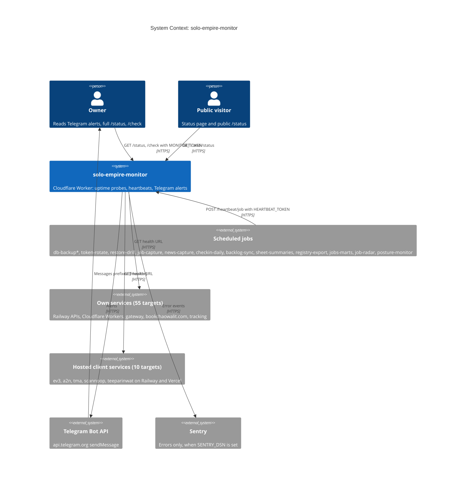

# 05 — C4 Context

Sources: `src/worker.ts`, `src/targets.ts`, `src/sentry.ts`, `wrangler.toml`, `README.md`

หมายเหตุ: `monitor.bookchaowalit.com` ชี้ไป Vercel ไม่ใช่ Worker นี้ (`README.md`, `PRODUCT.md`) จึงไม่อยู่ในภาพ
