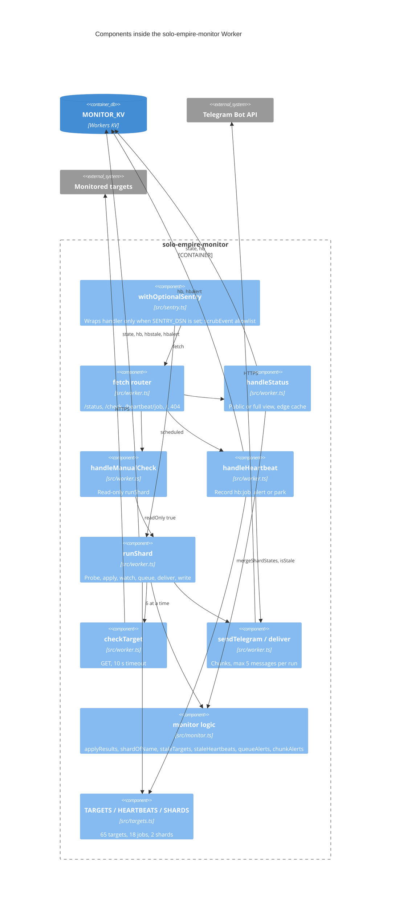

# 07 — C4 Component

แยกเป็น 4 module: `worker.ts` (Workers APIs: routing, KV, fetch, Telegram), `monitor.ts` (pure logic, ไม่มี Workers API เพื่อ unit test), `targets.ts` (config ในโค้ด), `sentry.ts` (optional wrapper)

Sources: `src/worker.ts`, `src/monitor.ts`, `src/targets.ts`, `src/sentry.ts`
