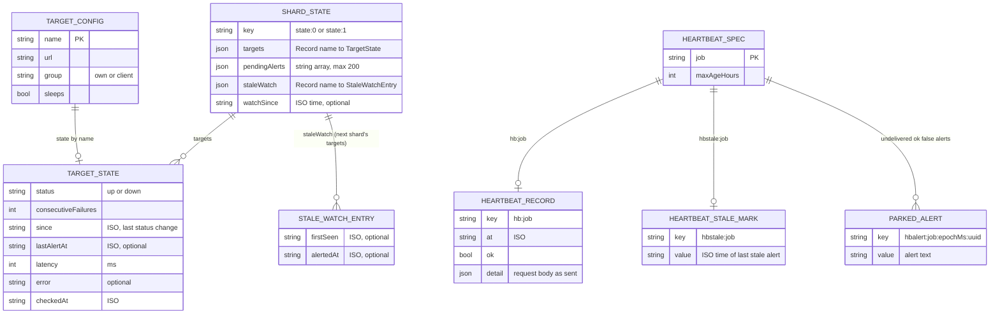

# 09 — ERD (Workers KV `MONITOR_KV`)

ไม่มี SQL database; ข้อมูล persisted ทั้งหมดอยู่ใน KV namespace เดียว (`wrangler.toml` binding `MONITOR_KV`) แบ่งด้วย key prefix ภาพนี้แทน key/value เป็น entity และ field จาก TypeScript types ใน `src/monitor.ts` ส่วน config (targets, heartbeat specs) อยู่ในโค้ด ไม่ได้ persisted

Sources: `src/monitor.ts` (`TargetState`, `HeartbeatRecord`, `ShardState`, `StaleWatch`, `MAX_PENDING_ALERTS`), `src/worker.ts` (`stateKey`, `heartbeatKey`, `staleKey`, `hbAlertKey`, `readShard` รองรับรูปแบบ pre-v2.1), `src/targets.ts` (`Target`, `HeartbeatSpec`), `wrangler.toml`

Edge cache (`caches.default`, key `/status`) เก็บ public JSON 60 s เป็น cache ไม่ใช่ข้อมูลหลัก

| Key | Writer | Reader | ลบเมื่อ |
|---|---|---|---|
| `state:<shard>` | cron shard นั้น (1 put ต่อรอบ) | cron ทั้งสอง shard, `/status`, `/check` | ไม่ลบ (overwrite) |
| `hb:<job>` | `POST /heartbeat/<job>` | cron shard 0, full `/status` | ไม่ลบ |
| `hbstale:<job>` | cron shard 0 | cron shard 0 | ไม่ลบ |
| `hbalert:<job>:<ms>:<uuid>` | heartbeat handler เมื่อ Telegram ล้ม | cron shard 0 (`list` ≤ 3) | หลัง Telegram รับ |

## Open questions

- `detail` ของ heartbeat เก็บ body ทั้งก้อนโดยไม่จำกัดขนาด และคืนใน full `/status` ควรจำกัดขนาดหรือ field หรือไม่
- KV ไม่มี TTL บน key ใด; `hb:` ของ job ที่ถูกถอดออกจาก `HEARTBEATS` จะค้างอยู่
