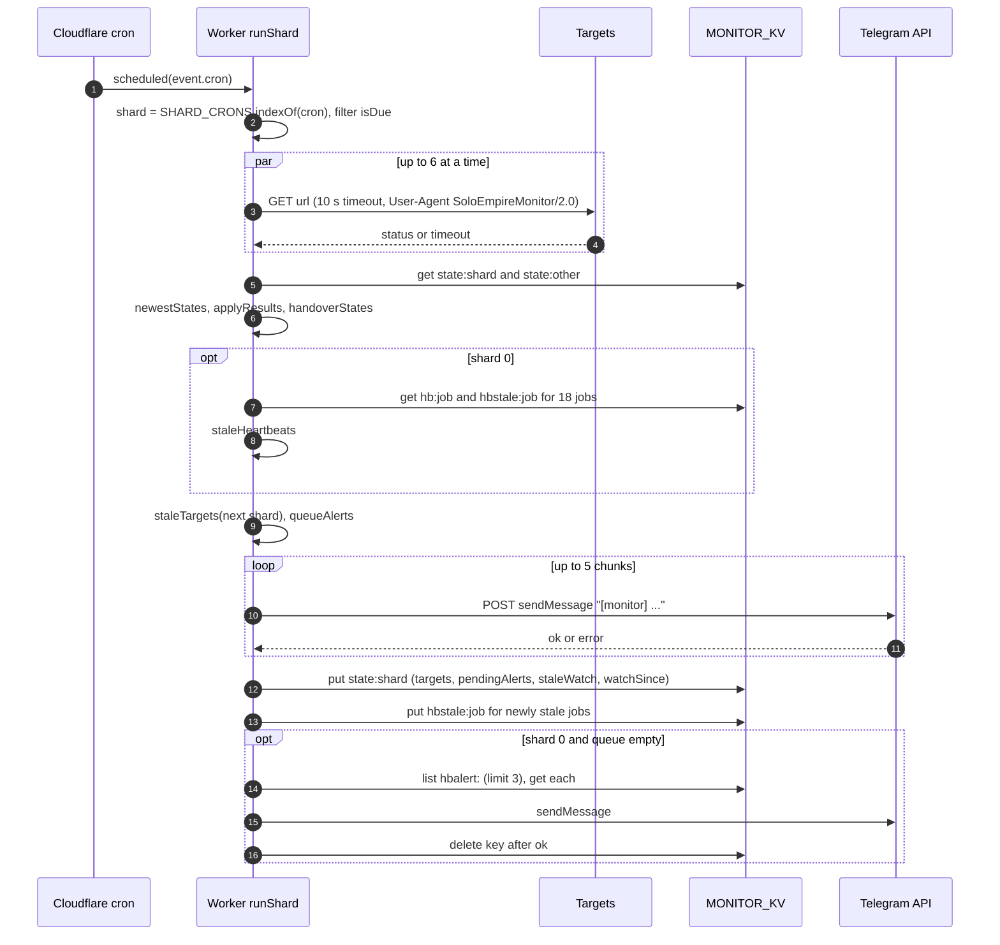
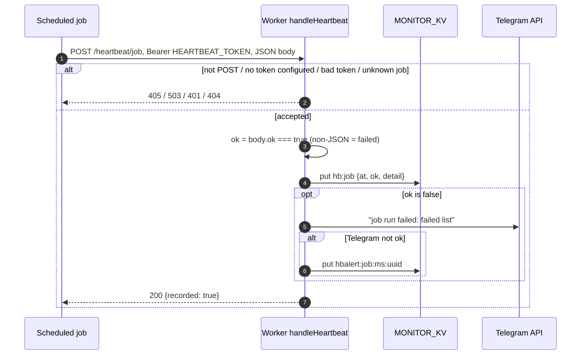
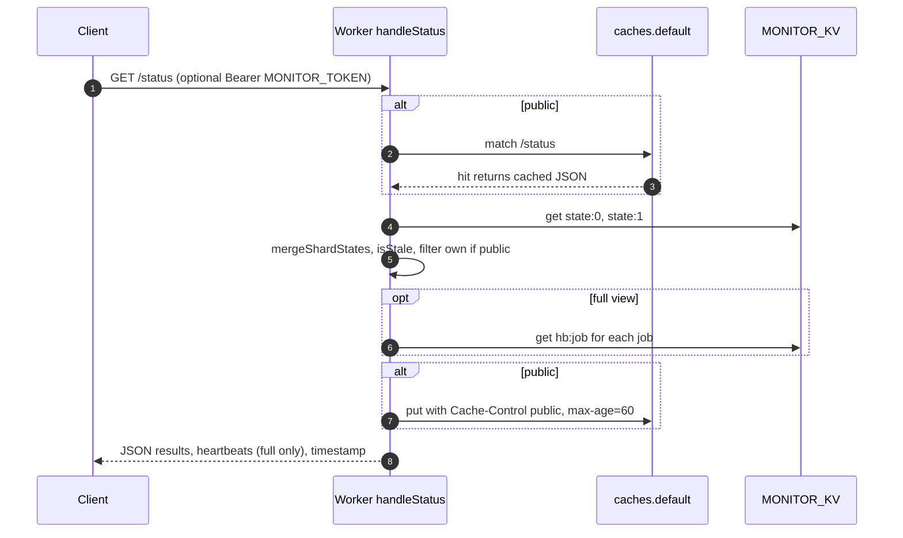
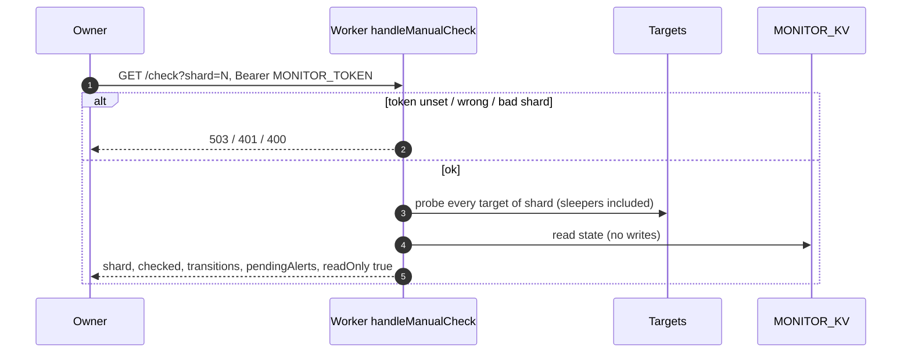

# 10 — Sequence diagrams

## 1. Cron shard run (`scheduled` → `runShard`, readOnly false)

## 2. Heartbeat report (`POST /heartbeat/<job>`)

## 3. Public and full `/status`

## 4. Manual check (`GET /check?shard=N`)

Sources: `src/worker.ts`, `src/monitor.ts`, `test/worker.test.ts`
