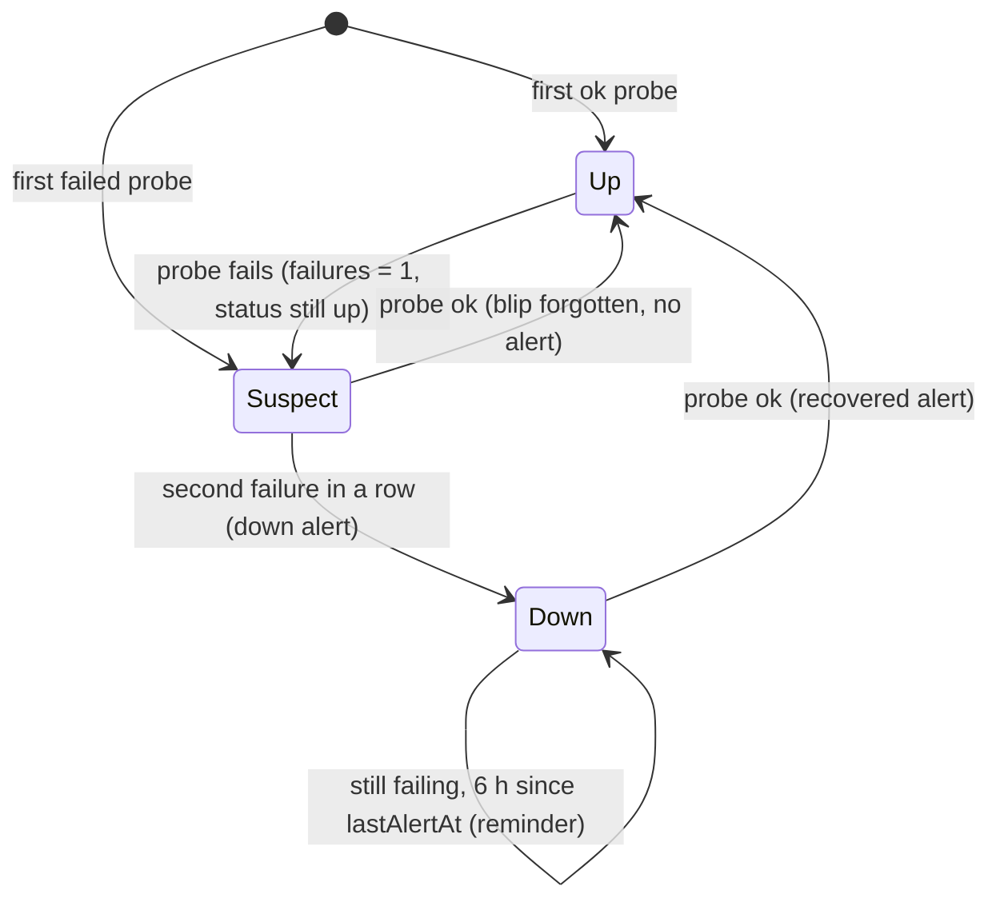
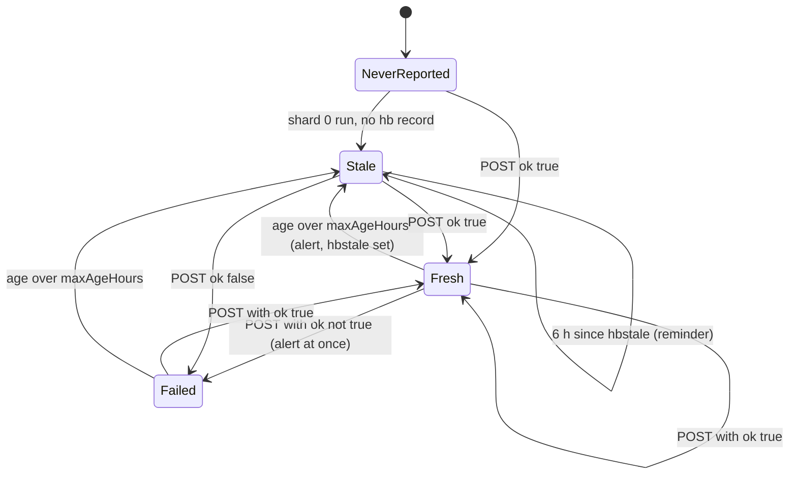
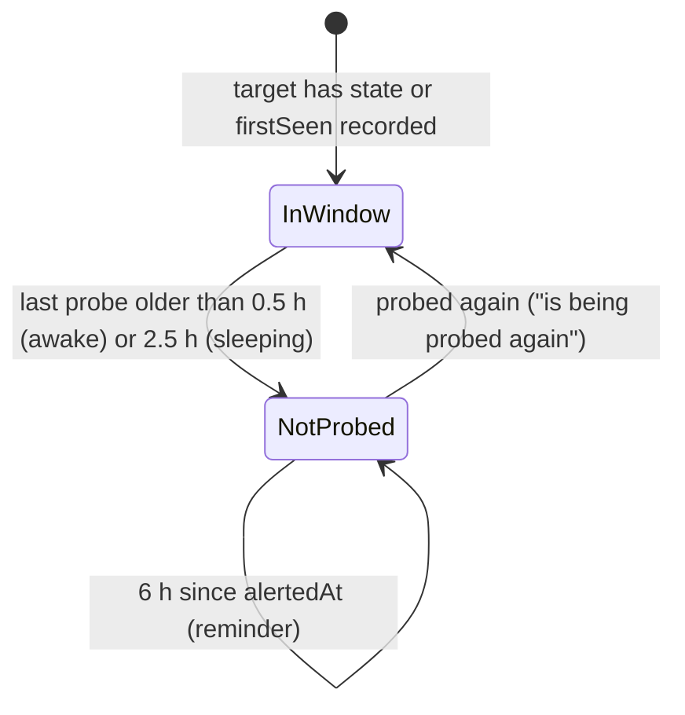
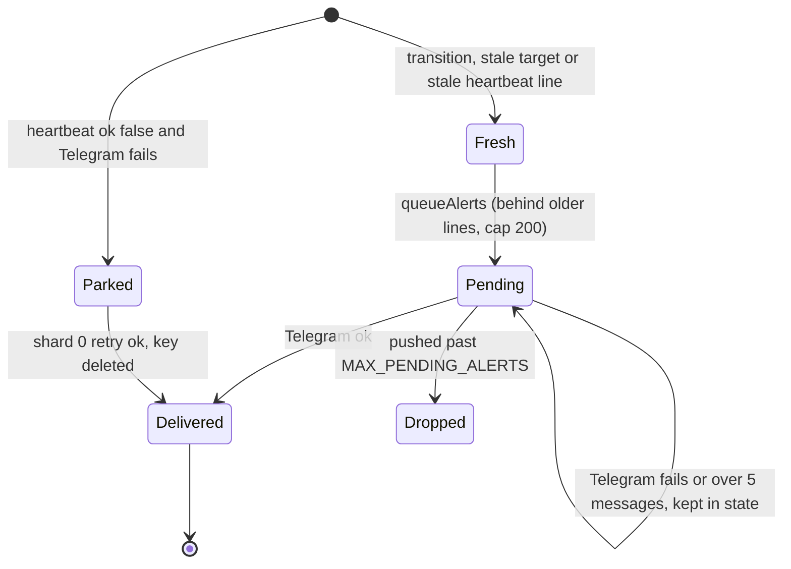

# 11 — State machines

## Target status (`TargetState.status` + `consecutiveFailures`)

Sources: `src/monitor.ts` `applyResults`, `FAILURES_BEFORE_DOWN = 2`, `REMINDER_HOURS = 6`; `test/monitor.test.ts` "applyResults"

## Heartbeat job

Sources: `src/worker.ts` `handleHeartbeat`, `runShard`; `src/monitor.ts` `staleHeartbeats`; `src/targets.ts` `HEARTBEATS`

## Stale-probe watch (each shard watches the next)

Sources: `src/monitor.ts` `staleTargets`, `STALE_AFTER_HOURS`, `watchedShard`

## Alert delivery

Sources: `src/worker.ts` `deliver`, `HB_ALERT_PREFIX`, `MAX_PARKED_PER_RUN`; `src/monitor.ts` `queueAlerts`, `MAX_PENDING_ALERTS`
