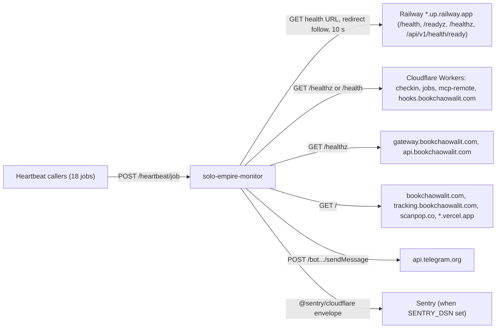

# 12 — API and integrations

## Endpoints (`src/worker.ts` `fetch`)

| Method | Path | Auth | Response | หมายเหตุ |
|---|---|---|---|---|
| any | `/` | none | `text/html` status page | script fetch `/status` |
| any | `/status` | none หรือ `Bearer MONITOR_TOKEN` | JSON `{results[], heartbeats?, timestamp}`; public: `name, group, status, stale, since, latency, checkedAt` ของ own เท่านั้น; full: เพิ่ม `url`, `error` และ heartbeats | public edge-cached 60 s; ไม่ตรวจ method |
| any | `/check?shard=0\|1` | `Bearer MONITOR_TOKEN` | JSON `{shard, checked, transitions, pendingAlerts, readOnly, timestamp}` | 503 ถ้าไม่ตั้ง token, 401, 400 shard ผิด |
| POST | `/heartbeat/<job>` | `Bearer HEARTBEAT_TOKEN` | `{recorded: true}` | body JSON `{ok: true}` หรือ `{ok: false, failed: [...]}`; 405/503/401/404 |
| — | อื่น ๆ | — | 404 `Not found` | |

## Outbound integrations

Sources: `src/worker.ts` (`fetch`, `checkTarget`, `sendTelegram`), `src/targets.ts` (`railway()` helper, `ALL_TARGETS`, `HEARTBEATS`), `src/sentry.ts`, `README.md` Usage

## Heartbeat contract (jobs ที่ต้องรายงาน)

| Job | Window (h) | Producer ตาม comment ใน `src/targets.ts` |
|---|---|---|
| `db-backup`, `db-backup-ev3`, `-a2n`, `-tma`, `-scannpop`, `-teeparinwat` | 26 | Railway `ops-backups` และ db-backup service ในแต่ละ project |
| `token-rotate` | 192 | platform-empire token-rotate cron (Sundays) |
| `restore-drill` | 840 | platform-db-backup `scripts/restore-drill.sh` (monthly) |
| `job-capture` | 13 | career-job-scraper scheduled-capture workflow (6 h) |
| `news-capture` | 5 | content-news-scraper Railway cron (2 h) |
| `checkin-daily` | 25 | life-checkin-worker SPEC-002 |
| `backlog-sync` | 3 | platform-empire Railway cron (hourly :05) |
| `sheet-summaries` | 26 | data-lake-pipelines Railway cron (12:00 UTC) |
| `registry-export` | 26 | data-lake-pipelines Railway cron (23:40 UTC) |
| `x-lakehouse` | 11 | data-lake-pipelines Railway cron (01:20, 09:20, 15:20 UTC) |
| `jobs-marts` | 5 | data-lake-pipelines workflow (2 h at :47) |
| `job-radar` | 3 | sales-crm Railway cron (hourly :07) |
| `posture-monitor` | 13 | platform-posture-monitor workflow (6 h at :23) |

## Open questions

- `/status` และ `/` ตอบทุก HTTP method (ไม่มี method check) ตั้งใจหรือไม่
- ไม่มี OpenAPI / contract file สำหรับ heartbeat body; producer แต่ละตัวต้องรู้ shape `{ok, failed}` เอง
