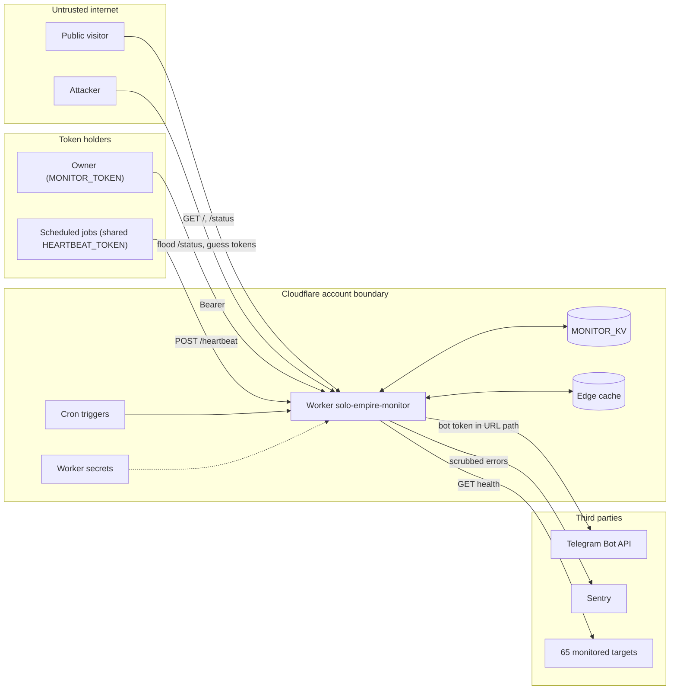

# 13 — Threat model (DFD + STRIDE)

reuse: central threat list T-01…T-09 ใน [04-feasibility.md](https://github.com/bookchaowalit/architecture-docs/blob/main/operations/platform/devsecops-phase2-prod-baseline/04-feasibility.md) และ risk R-08 ใน 00-governance.md ไฟล์นี้วาดจากโค้ดปัจจุบันและเพิ่มสิ่งที่ไม่มีในนั้น

Sources: `src/worker.ts`, `src/sentry.ts`, `wrangler.toml`, `README.md` (Deploy, Known limits)

| Element | STRIDE | Threat | Mitigation ในโค้ด | Gap |
|---|---|---|---|---|
| `/heartbeat/<job>` | S | ปลอม heartbeat ของ job ใดก็ได้ | Bearer `HEARTBEAT_TOKEN`; job ต้องอยู่ใน `HEARTBEATS` | token เดียวใช้ร่วมทุก job: ผู้ถือ token ของ job หนึ่งปิด alert ของ job อื่นได้ |
| `/heartbeat/<job>` | T | body ใหญ่หรือมีเนื้อหาแปลก | non-JSON = failed run | ไม่จำกัดขนาด `detail`; เก็บลง KV และคืนใน full `/status` |
| `/heartbeat/<job>` | R | ไม่รู้ว่าใครส่ง | `hb:job.at` | ไม่มี caller identity หรือ audit log |
| Token check | S | timing attack บน token | `authorized()` เทียบ string ตรง ๆ | ไม่ใช่ constant-time compare (ความเสี่ยงต่ำบน edge) |
| `/status` public | I | เปิดเผย client / URL / error | filter `group === 'own'`, ไม่มี url/error (test "shows only own services publicly") | ชื่อ own services และ latency เป็นสาธารณะโดยตั้งใจ |
| `/status` public | D | flood cache miss ใช้ KV reads 100k/day หมด แล้ว cron อ่าน KV ไม่ได้ | edge cache 60 s | ไม่ coalesce miss, ไม่มี rate limit (accepted, `README.md` Known limits) |
| `/check` | D | probe ทุก target ซ้ำ ๆ | ต้องมี `MONITOR_TOKEN`; read-only | ไม่มี rate limit สำหรับผู้ถือ token |
| Cron | D | cron ทั้งสองหยุด / account มีปัญหา | cross-shard stale watch (`staleTargets`) | ถ้าทั้งสองหยุด เงียบ (R-08 / BL-06, open) |
| Telegram | I | bot token รั่วผ่าน error | `scrubEvent` redact `/bot<token>`; `console.error` log แค่ status หรือ `error.message` | `error.message` จาก fetch อาจมี URL ที่มี token ไปถึง Workers logs (ยังไม่ยืนยัน) |
| Telegram | D | token ถูก revoke, alert หาย | queue `pendingAlerts` + parked `hbalert:*` | ช่องทางเดียว (central INC-02) |
| Sentry | I | PII/secret ใน event | errors only, `dataCollection` off, allowlist contexts, strip query | — |
| KV | T | เขียนทับ state | ใช้ได้เฉพาะ Worker binding | ไม่มี integrity check บน state |
| Secrets | I | secret ใน repo | secrets ผ่าน `wrangler secret put` จาก Infisical; CI มี gitleaks/semgrep/osv/trivy | `account_id` และ KV id อยู่ใน `wrangler.toml` (identifiers ไม่ใช่ secret) |
| Probes | E/S | target redirect ไป host อื่น | `redirect: 'follow'`, timeout 10 s, body drained | ไม่จำกัด host หลัง redirect (ผลกระทบแค่ผล probe) |

## Open questions

- ควรแยก heartbeat token ต่อ job หรือไม่
- ยืนยันว่า Workers logs ไม่มี Telegram URL พร้อม token จาก `console.error('Telegram send failed', error.message)`
- จะทำ BL-06 external dead-man check เมื่อไร
