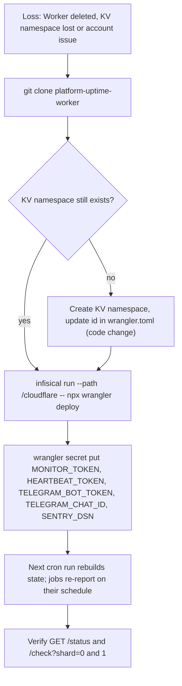

# 14 — Backup and DR

Worker นี้ "เฝ้า" backup ของระบบอื่น (heartbeat `db-backup*`, `restore-drill`) แต่ข้อมูลของตัวเองไม่มี backup ข้อมูลทั้งหมดอยู่ใน KV `MONITOR_KV` และ code/config อยู่ใน git

| Data | Where | Backup | ถ้าหาย |
|---|---|---|---|
| Source + targets + heartbeat specs | GitHub `bookchaowalit/platform-uptime-worker` (+ local clone) | git | redeploy |
| Worker secrets (`MONITOR_TOKEN`, `HEARTBEAT_TOKEN`, `TELEGRAM_*`, `SENTRY_DSN`) | Cloudflare Worker secrets | ค่าต้นทางใน Infisical `/monitoring`, `/telegram` (`README.md`) | `wrangler secret put` ใหม่ |
| `state:0`, `state:1` | KV | ไม่มี | รอบแรกหลังกู้: ทุก target เริ่มใหม่ (down ที่ค้างจะ alert ใหม่หลัง 2 fail; recovery ที่ค้างหาย); `watchSince` ใหม่ให้ window เต็ม |
| `pendingAlerts` | ใน `state:<shard>` | ไม่มี | alert ที่ยังไม่ส่งหาย |
| `hb:<job>` | KV | ไม่มี | ทุก job ถือว่า never reported → stale alert จน job รายงานรอบถัดไป |
| `hbalert:*` | KV | ไม่มี | failed-run alert ที่ยังไม่ส่งหาย |

Sources: `wrangler.toml`, `README.md` (Deploy, secrets table), `src/worker.ts` (`readShard` default state, `watchSince`), `src/monitor.ts` (`staleHeartbeats`, `staleTargets`)

- RTO / RPO ของ monitor เอง: not defined (ไม่มีใน repo หรือ central ADR-0002; NFR-06 ใน central 06 กำหนดเฉพาะ database backups: RPO ≤ 24 h, RTO ≤ 4 h ต่อ database)
- Restore drill: มีสำหรับ databases (heartbeat `restore-drill` 35 วัน) แต่ไม่มี drill สำหรับ Worker นี้

## Open questions

- ต้องการ RTO/RPO สำหรับ monitor หรือไม่ (state สร้างใหม่ได้ใน ~5 นาที แต่ยังไม่มีตัวเลขที่ตกลงกัน)
- ควร export KV เป็นระยะไหม หรือยอมรับว่า state เป็น disposable
