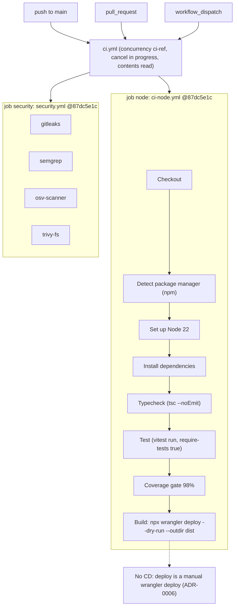

# 15 — CI/CD pipeline

workflow เดียว `.github/workflows/ci.yml` เรียก reusable workflows จาก `bookchaowalit/platform-ci-workflows` pinned SHA `87dc5e1c…` (v1.1.1) repo เป็น public จึงใช้ GitHub-hosted runner (`ubuntu-24.04` default ของ ci-node) ไม่มี deploy job

Sources: `.github/workflows/ci.yml`, `package.json` (scripts), platform-ci-workflows `ci-node.yml` และ `security.yml` ที่ commit `87dc5e1c7e0416886a6371d5a101bb2ccba38edd`, `renovate.json`

หมายเหตุ:
- ci-node มี step Lint และ Start PostgreSQL ที่ข้ามเมื่อไม่มี lint script / `postgres: false` (default)
- Renovate (`renovate.json`): Monday ก่อน 09:00 Asia/Bangkok, group `platform-ci-workflows` และ `npm non-major`, lock file maintenance วันที่ 1 ของเดือน
- ผลจริง 90 วัน (`gh run list --created '>=2026-08-05'`): push 22 runs (21 success, 1 failure `27bf995` 2026-10-24), pull_request 21 (19 / 2), workflow_dispatch 1 (1 / 0)

## Open questions

- ควรมี deploy job (เช่น `wrangler deploy` หลัง CI เขียว) หรือคง manual ไว้
