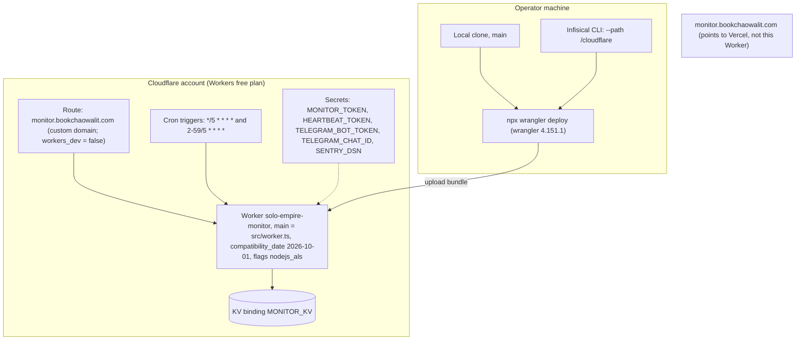

# 16 — Deployment

Sources: `wrangler.toml`, `package.json`, `README.md` (Deploy, secrets, ที่มา), `PRODUCT.md`

| Item | Value |
|---|---|
| Hosting | Cloudflare Workers free plan |
| Environments | production เท่านั้น (ไม่มี `[env.*]` ใน `wrangler.toml`) |
| Custom domain | `monitor.bookchaowalit.com` (2026-11-04); `workers.dev` ปิด |
| Bindings | KV `MONITOR_KV` อย่างเดียว (ไม่มี D1 / R2 / DO / Queue) |
| Deploy trigger | manual; ไม่ใช่ push to `main` |
| Deployment history | `wrangler deployments list` (ล่าสุด 10 ครั้ง, `source: wrangler`) |
| Rollback | ไม่มีเอกสารใน repo; Wrangler รองรับ `wrangler rollback` แต่ไม่ได้ระบุใน README |

## Open questions

- ควรย้าย `monitor.bookchaowalit.com` มาที่ Worker นี้ไหม
- rollback procedure ที่ใช้จริงคืออะไร
