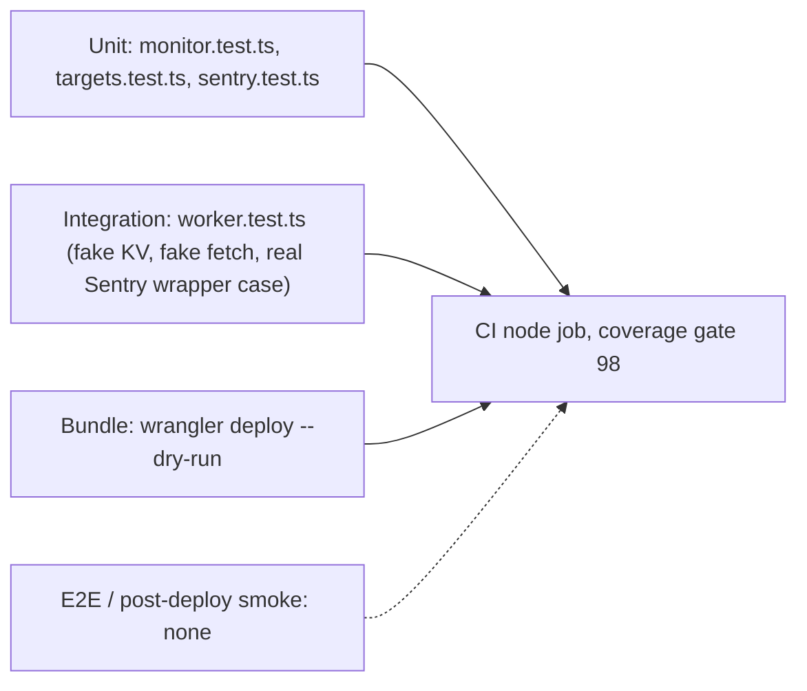

# 17 — Test coverage matrix

tests ทั้งหมดเป็น Vitest offline (in-memory KV, stubbed fetch) 4 ไฟล์ ไม่มี e2e กับ Worker runtime จริงหรือ smoke test หลัง deploy CI gate line coverage 98% (`ci.yml` comment: measured 98.01%)

ระดับ: **unit** = pure functions ใน `monitor.ts` / `targets.ts` / `sentry.ts`; **integration** = เรียก `worker.default.fetch/scheduled` กับ fake KV + fake fetch (`worker.test.ts`); **e2e** = ไม่มี

| Feature | Unit | Integration | E2E | Gap |
|---|---|---|---|---|
| Down after 2 failures / reminder / recovery | `monitor.test.ts` applyResults | `worker.test.ts` "alerts after two failures in a row, then on recovery" | — | |
| Shard assignment and state hygiene (TD-004) | `monitor.test.ts` (11 cases) | `worker.test.ts` "reads each target from the shard that owns it" | — | |
| Stale-probe watch | `monitor.test.ts` staleTargets (6) | — | — | ไม่มี integration ของ alert line ผ่าน `runShard` |
| Sleeping services hourly | `monitor.test.ts` isDue; `targets.test.ts` | `worker.test.ts` "skips sleeping services outside their hourly slot" | — | |
| Subrequest budget | `monitor.test.ts`, `targets.test.ts` | — | — | ไม่ได้วัดใน runtime จริง |
| Heartbeat endpoint | — | `worker.test.ts` /heartbeat (7 cases) | — | |
| Missed heartbeat + parked alert delivery | `monitor.test.ts` staleHeartbeats (4) | `worker.test.ts` "on shard 0, alerts once ..." | — | |
| Alert queue / chunking | `monitor.test.ts` queueAlerts, chunkAlerts | `worker.test.ts` "keeps an undelivered alert queued" | — | |
| Public / full `/status`, edge cache | — | `worker.test.ts` /status (5 cases) | — | |
| `/check` read-only | — | `worker.test.ts` /check (4 cases) | — | |
| Routing `/`, 404 | — | `worker.test.ts` routing (2) | — | HTML page script ไม่ได้ทดสอบ |
| Target list rules (https, unique, Happy Teeth absent, health paths) | `targets.test.ts` TARGETS (8) | — | — | ไม่ได้ตรวจว่า URL ตอบจริง |
| Heartbeat specs windows | `targets.test.ts` HEARTBEATS (12) | — | — | |
| Sentry options + scrub | `sentry.test.ts` (10) | `worker.test.ts` "with SENTRY_DSN set" | — | |
| Deploy bundle | — | CI build `wrangler deploy --dry-run` | — | ไม่มี post-deploy smoke |

Sources: `test/monitor.test.ts`, `test/targets.test.ts`, `test/worker.test.ts`, `test/sentry.test.ts`, `.github/workflows/ci.yml`, `README.md` Tests

## Open questions

- ต้องการ post-deploy smoke (`GET /status`, `/check`) เป็น step บังคับหรือไม่
