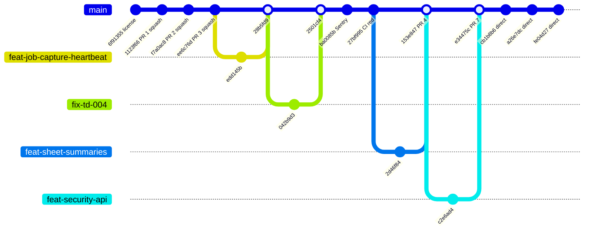
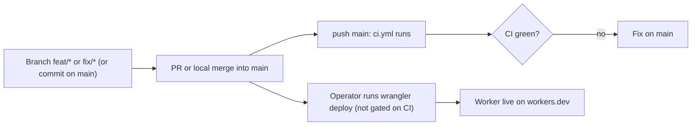

# 18 — Git and release workflow

จาก `git log --first-parent origin/main` (2026-10-17 → 2026-11-03) และ `gh pr list --state all`: มีทั้ง PR (#1–#7), local merge ของ feature branch (`Merge branch 'feat/...'`, ตาม ops rule "merge locally") และ commit ตรงบน `main` (เช่น `cb1b8b6`, `a26e7dc`, `fe04d27`) `main` ไม่มี branch protection (`gh api repos/bookchaowalit/platform-uptime-worker/branches/main/protection` → 404)

ภาพนี้ย่อเฉพาะบาง commit; ลำดับและ SHA ตรงกับ `git log --first-parent`

Sources: `git log --first-parent origin/main`, `gh pr list --state all`, `gh run list`, `wrangler deployments list`, `.github/workflows/ci.yml`, `README.md` Deploy

## Open questions

- ควรเปิด branch protection / required checks บน `main` หรือไม่
- ไม่มี tag หรือ release; จะใช้ version อะไรอ้างอิง deployment
