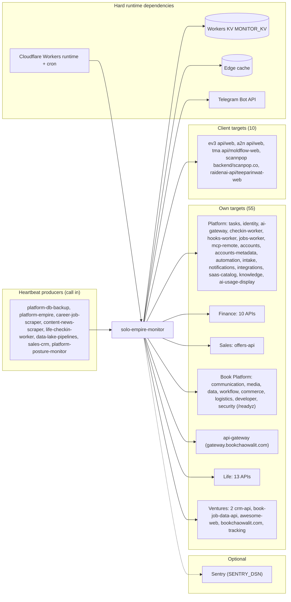

# 19 — Service dependency map

Runtime dependencies ของ Worker (ซ้าย = สิ่งที่ Worker ต้องใช้เพื่อทำงาน, ขวา = สิ่งที่ถูกเฝ้า) ชื่อ target ทั้งหมดจาก `src/targets.ts` จัดกลุ่มตาม comment ในไฟล์

Sources: `src/targets.ts`, `src/worker.ts`, `src/sentry.ts`, `wrangler.toml`

| Dependency | ถ้าล่ม |
|---|---|
| Cloudflare cron | ไม่มี probe; shard ที่เหลือรายงาน "not probed"; ทั้งสองหยุด = เงียบ |
| KV | `readShard`/`put` throw → รอบนั้นล้ม (ไป Sentry ถ้าเปิด) |
| Telegram | alert ค้างใน queue / parked keys |
| Sentry | ไม่กระทบการทำงาน |
| Target provider (Railway / Vercel) ล่มทั้งหมด | alert หลาย target พร้อมกัน (central runbook "Many targets down at once") |

## Open questions

- `payment-api` ยังไม่อยู่ใน targets (ops record: book-platforms-status, 2026-11-03: รอ Stripe key)
