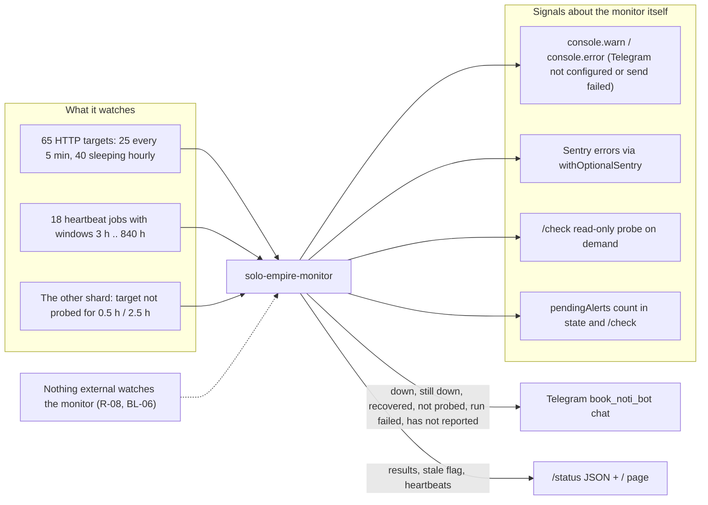

# 20 — Observability

repo นี้ **คือ** uptime monitor + heartbeat hub ของทั้ง estate (ส่วนหนึ่งของ prod baseline, central ADR-0002) ภาพนี้แยก (ก) สิ่งที่มันเฝ้า และ (ข) สัญญาณของตัวมันเอง

Sources: `src/worker.ts`, `src/monitor.ts`, `src/targets.ts`, `src/sentry.ts`, `wrangler.toml`, `PRODUCT.md`, `README.md`

| Signal | Source | Destination | Watched by |
|---|---|---|---|
| Probe result, latency, error | `checkTarget` | KV `state:<shard>`, `/status` | owner via Telegram / `/status` |
| Transitions | `applyResults`, `formatTransitions` | Telegram | owner |
| Stale target | `staleTargets` | Telegram, `stale` flag ใน `/status` | owner |
| Heartbeat | `POST /heartbeat/<job>` | KV `hb:<job>`, Telegram on `ok:false` | owner |
| Missed heartbeat | `staleHeartbeats` (shard 0) | Telegram | owner |
| Worker errors | `@sentry/cloudflare` | Sentry project `personal-yu0/platform-uptime-worker` (`PRODUCT.md`) | owner |
| Worker logs | `console.*` | Cloudflare Workers logs | ไม่มีใครเฝ้า; `wrangler.toml` ไม่มี `[observability]` block |

ไม่มี PostHog, metrics หรือ tracing (tracing ปิดโดยตั้งใจใน `sentry.ts`)

## Open questions

- เปิด Workers Logs (`[observability] enabled = true`) หรือไม่
- BL-06: ใครหรืออะไรจะเฝ้า monitor (เช่น heartbeat ภายนอก หรือข้อความ "still alive" รายวัน)
