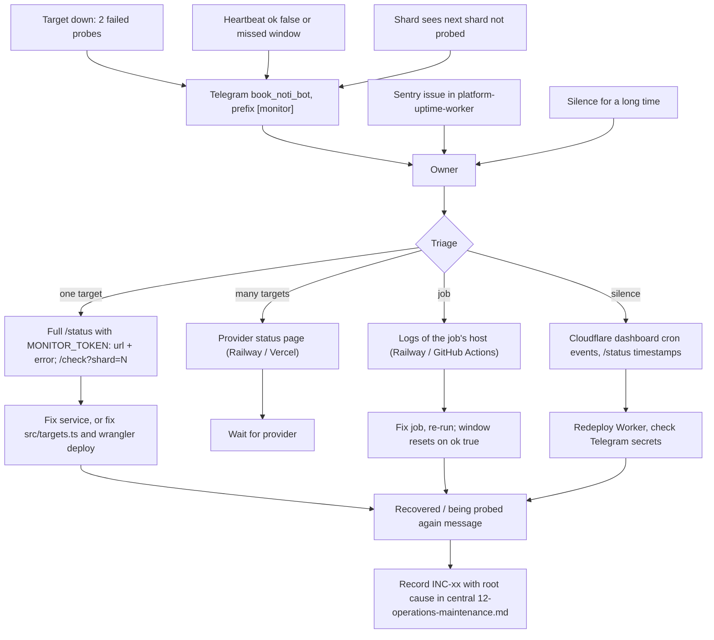

# 21 — Incident response

reuse: runbook และ incident log อยู่ใน central [12-operations-maintenance.md](https://github.com/bookchaowalit/architecture-docs/blob/main/operations/platform/devsecops-phase2-prod-baseline/12-operations-maintenance.md) ("Operations runbook, monitoring" และ "Incident report + RCA" INC-01..INC-04) ใน repo นี้ไม่มี runbook หรือ postmortem template ของตัวเอง ภาพนี้ใช้ช่องทาง alert จริงจากโค้ด

Sources: `src/worker.ts`, `src/monitor.ts` (`formatTransitions`, `staleTargets`), `README.md`, central `12-operations-maintenance.md`

ตัวอย่างจริงที่บันทึกไว้: INC-02 (2026-10-18) alert ไม่ถึงเพราะ Telegram token ถูก revoke; queue ช่วยให้ alert ถูกส่งหลังเปลี่ยนเป็น `book_noti_bot` ops record: job-system-hosted-capture (2026-11-03) บันทึกว่า job-radar ไม่ทำงาน 10-29 → 11-03 โดยไม่มีใครรู้ จึงเพิ่ม heartbeat `job-radar` (ตรงกับ comment ใน `src/targets.ts`)

## Open questions

- ไม่มี severity levels, on-call หรือ SLA สำหรับ client targets ที่เราโฮสต์ ต้องการหรือไม่
- postmortem ของเหตุหลัง 2026-10-18 (เช่น job-radar เงียบ) บันทึกไว้ที่ไหน
