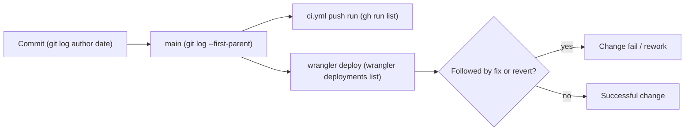

# 22 — DORA metrics

ช่วงวัด: 90 วันถึง 2026-11-03 (`--since=2026-08-05`) Deploy ของ repo นี้เป็น manual `wrangler deploy` ไม่มีใน GitHub จึงใช้ `wrangler deployments list` (Cloudflare API คืนแค่ 10 ครั้งล่าสุด: 2026-10-26 → 2026-11-03) ทุกครั้ง `source: wrangler`



Sources: `git log`, `gh run list`, `wrangler deployments list`

| Metric | วิธีวัดสำหรับ repo นี้ | ค่า (90 วัน) | หมายเหตุ |
|---|---|---|---|
| Deployment frequency | นับ `wrangler deployments list` | ≥ 10 (10 ครั้งใน 9 วัน 2026-10-26 → 11-03, ≈ 1.1/day) | ก่อน 2026-10-26 ดูไม่ได้ (API คืน 10 ล่าสุด); first-parent changes บน `main` 90 วัน = 30 |
| Lead time for changes | deploy time − author time ของ commit เก่าสุดที่ deploy นั้นนำเข้า (จับคู่ deploy กับ main SHA จากเวลา push CI ที่ใกล้ที่สุด) | median ≈ 0.015 h (≈ 1 นาที), range 0.00 – 2.30 h, n = 10 | สั้นเพราะ deploy ทันทีหลัง commit และไม่รอ CI |
| Change fail rate | deploy ที่ตามด้วย `fix:`/`revert:` บน main ก่อน deploy ถัดไป | 0 / 10 ในช่วงที่มีข้อมูล deploy | proxy 90 วัน: 5 `fix` commits / 35 non-merge commits (`325ffb5`, `042b9d3`, `4d85f98`, `ee6c76d`, `1948257`) และ CI บน main แดง 1/22 (`27bf995`) |
| Failed deployment recovery time | เวลาจาก deploy ที่ล้มถึง deploy ที่แก้ | not computable | ไม่มี record ของ deploy ที่ล้มหรือ incident ผูกกับ deploy |
| Deployment rework rate | deploy ที่เป็นการแก้ deploy ก่อนหน้า (unplanned) / ทั้งหมด | 0 / 10 | ทั้ง 10 deploy เป็น `feat` หรือ merge ของ `feat` |

## Commands

```bash
# Deployment list (needs Cloudflare credentials from Infisical, read-only)
source ~/.config/solo-empire/environment.sh
infisical run --projectId "$INFISICAL_PROJECT_ID" --env dev --path /cloudflare --silent -- \
  npx wrangler deployments list --json

# main history and fixes
git log --first-parent origin/main --since=2026-08-05 --format='%h %ad %s' --date=iso-strict | wc -l   # 30
git log origin/main --since=2026-08-05 --no-merges --format='%h' | wc -l                               # 35
git log origin/main --since=2026-08-05 --format='%h %s' | grep -iE '^[0-9a-f]+ (fix|revert)'            # 5

# CI runs on main
gh run list --limit 200 --branch main --event push --created '>=2026-08-05' \
  --json conclusion,createdAt,headSha --jq '.[] | "\(.createdAt) \(.conclusion) \(.headSha[0:7])"'

# Lead time per deploy: oldest author date in prev..sha
git log --format=%aI <prev_sha>..<sha> | tail -1
```

## Deploy ↔ commit mapping used

| Deploy (UTC) | main SHA | commits | lead time (h) |
|---|---|---|---|
| 2026-10-26 12:54:35 | `153e847` | 3 | 0.04 |
| 2026-10-27 09:20:26 | `7603e3e` | 2 | 2.30 |
| 2026-10-27 15:59:50 | `6831b8d` | 2 | 0.02 |
| 2026-10-29 07:02:00 | `ee0d764` | 2 | 0.19 |
| 2026-11-02 15:46:47 | `e34475c` | 2 | 0.16 |
| 2026-11-02 17:06:23 | `25eb183` | 2 | 0.01 |
| 2026-11-03 03:21:21 | `cb1b8b6` | 1 | 0.00 |
| 2026-11-03 05:04:44 | `a26e7dc` | 1 | 0.00 |
| 2026-11-03 05:43:30 | `29be4fc` | 2 | 0.00 |
| 2026-11-03 15:57:48 | `fe04d27` | 1 | 0.00 |

Mapping ใช้เวลาที่ใกล้ที่สุดกับ CI push run ของ SHA นั้น เพราะ Cloudflare deployment ไม่บันทึก git SHA (ไม่มี `--tag` / `--message`)

## Open questions

- ให้ใส่ `--tag <sha>` หรือ `--message` ตอน `wrangler deploy` เพื่อให้ DORA วัดได้ตรงหรือไม่
- deploy ก่อน CI เสร็จ (เช่น `fe04d27`) ควรถือเป็นความเสี่ยงที่ต้องแก้ไหม
